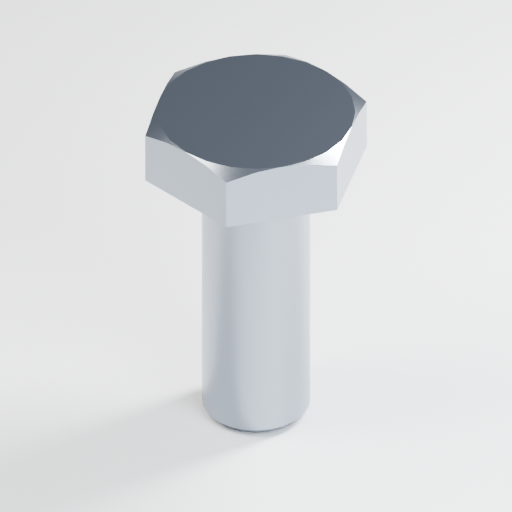
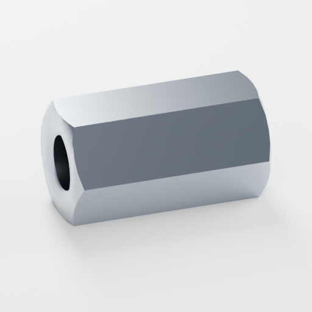

# oomp_hardware_bolt_version_5

Generated bolt, hex screw, nut and washer definitions and 3D outputs for the OOMLout/OOBB hardware catalog.

## Overview

This repository stores 207 hardware variants. `working_oomp_populate_*.py` defines
their taxonomy; nonempty taxonomy fields form each product ID and folder name.
`parts_source/<id>/working.yaml` holds source definitions and
`parts/<id>/working.yaml` holds generated metadata. Existing SVG dimension inputs
come from `source_file/dimension/`. The independent model pipeline uses sourced
tables in `source_file/standards/` and preserves legacy assets.

This repository is part of the larger [oomlout_oomp_version_5](https://github.com/oomlout/oomlout_oomp_version_5) toolchain for building reusable hardware part libraries, rather than a standalone Python package.

Supplier CSVs and search snapshots are copied from
`C:\od\OneDrive\docs\project_bolt_web_scraper\data` into
`source_file/supplier_data/` and `source_file/search/` with
`action_update_from_scraper.bat` (or `python working_supplier_data.py`). The search
snapshot includes its evidence files.
Population attaches matching records to each part under a supplier-keyed
`supplier_data` mapping. Verified SKUs and URLs are combined with harvested
stock, pack, VAT, capture and price fields; price values remain exact strings.
Supplier snapshots are keyed to their mapped OOMP IDs and attach only where the
generated part has the same ID.
Search results attach under `search_data`, keyed by platform, when the OOMP ID
matches a generated part. Running `action_make_all.py` regenerates those fields
in the corresponding `parts/<id>/working.yaml` files.

## Example Images





## Quick Start

If you only want to browse the generated outputs, start in:

- `parts/` for per-part folders
- `navigation_oobb/` for a generated navigation tree

If you have the external OOMLout dependencies installed locally, the main entry points in this repo are:

```bash
python working.py
python action_make_all.py
```

`working.py` orchestrates population, metadata, SCAD, SVG, parametric 3D and actions.
Disable the independent 3D stage with `working.run(run_three_d_model=False, ...)`.
The model stage runs only after generated part folders exist; its worker count
defaults to one (`model_jobs=3` selects three). Existing OOMP/OOBB stages keep their
own dependencies.

## Independent parametric models and studio rendering

Install the dependencies and Blender **4.5 or newer**:

```powershell
python -m pip install -r requirements-three-d-model.txt
python working_three_d_model.py --update-metadata --metadata-only
python working_three_d_model.py --filter hardware_bolt_m6_30_mm_length
```

Blender is discovered through `OOMP_BLENDER_EXE`, PATH, then normal installation
locations. This machine uses `C:\Program Files\Blender Foundation\Blender 5.2\blender.exe`.
The pipeline is independent of the screw reference repository: all adapted code
is local. `reference_source_snapshot.json` records the authoritative root sources
inspected during setup; no reference scripts or batch files were run or changed.

Recipes now cover **207 parts in both stores**, including the 45 formerly unsupported entries.
Of those additions, 20 use published supplier envelope dimensions with explicitly
selected small features; **25 are labelled approximate visual models**. See
`three_d_model_coverage.json` for the approximation list and reasons. Exact M1.5
and M2.7 catalogue identities are retained; unverified thread/dimension choices
are never represented as standard-compliant supplier products.

| Family | Supported catalogue range | Dimension source and status |
| --- | --- | --- |
| Partially threaded hex bolt | M4–M8, 40 parts | ISO 4014:2011; nominal head, grades A/B by length; b changes at 125/200 mm |
| Fully threaded hex screw (`set_screw`) | M3–M8, 79 parts | Westfield ISO 4017 supplier table; edition not stated; catalogue lengths explicitly unverified by that table |
| Nylon hex screw | M6, 6 parts | Westfield/Kramp DIN 933-style supplier dimensions; no ISO material-compliance claim |
| Plain hex nut, including black M3 | M2, M2.5, M3–M8, 8 parts | ISO 4032:2012, matching the existing CSV rather than substituting DIN 934 heights |
| Miniature plain nut | M1, M1.4, 2 parts | Accu miniature supplier dimensions; not extrapolated ISO 4032 rows |
| Nylon plain nut | M3–M8, 5 parts | Accu HPN DIN 934-based supplier dimensions; e.g. M6 is 5 mm high rather than ISO 4032's 5.2 mm |
| Plain flange nut | M3–M8, 5 parts | Westfield DIN 6923 sheet; M3/M4 explicitly manufacturer extensions |
| Coupling nut | M5, M6, M8, 3 parts | Westfield commercial article 6334; TOBSTEEL explicitly identifies it as an article, not a published DIN standard |
| Form A washer | M2, M2.5, M3–M8, 7 parts | Westfield DIN 125 A dimensional sheet; unchamfered |
| Penny washer | M2.5, M3–M8, 6 parts | Westfield DIN 9021 dimensional pattern, selected because exact catalogue supplier is unspecified |
| Nylon washer | M6, 1 part | Catalogue 12 mm OD and 1.5 mm thickness; 6.4 mm supplier clearance hole is an explicit assumption |

Sources, editions where known, limits, selected dimensions, finish approximations
and assumptions live in `source_file/standards/catalogue_hardware.yaml` and each
persisted recipe. Sources include the [ISO 4014:2011 dimensional preview](https://cdn.standards.iteh.ai/samples/56447/be5b2835974246f8868260ebe9f4d621/ISO-4014-2011.pdf),
[ISO 4032:2012 dimensional preview](https://cdn.standards.iteh.ai/samples/61668/93b89b8502a943499386155c44018aaa/ISO-4032-2012.pdf),
[flange nut supplier sheet](https://www.westfieldfasteners.co.uk/Standards/Nut-HexFlgPln-M.pdf)
and [washer supplier sheet](https://www.westfieldfasteners.co.uk/Standards/Washer-FormA-M.pdf).
These are historical dimensional selections, not certification to current editions.

The additional recipes live in `source_file/standards/catalogue_extensions.yaml`:

- All locking nuts use the owner-confirmed **nylon insert** mechanism. D. S.
  Fasteners supplies M2-M8 DIN 985 envelope dimensions; miniature sizes are
  approximate. Steel and blue nylon are separate closed components/materials.
- Fasenco drawings supply the 2020 ball-spring and hammer-nut patterns. Ball
  dimensions, internal pockets and some shoulder details are visual selections;
  the hidden spring is omitted. M3/M6 hammer variants are labelled adaptations.
- Value Fastener/Kanebridge M5/M6/M8 drawings supply cage envelope and sheet
  dimensions, converted from inches. Internal square nuts and formed clip
  details use documented visual selections. Cage and nut are separate solids.
- Fullerkreg supplies M3/M4 coupling dimensions. Spalding supplies M1 plain
  washer dimensions; Westfield supplies M2 large washers (2.2 x 7 x 0.8 mm).
- Tabco Optical confirms M1.5 x 0.30 and 2.25 mm flats; its missing height is
  approximate. M2.7, other miniature flange/coupling/locking nuts and the
  remaining small washers use owner-authorized, labelled visual approximations.

Each new output includes `model_notes.md`; approximation status is also in
`parameters.json`, YAML recipes, SVG titles and the manifest. These models are
catalogue illustrations, not verified profile-fit or manufacturing drawings.

```powershell
python working_three_d_model.py --add-missing-metadata --metadata-only
python generate_catalogue_extensions.py --jobs 1
```

The first command adds recipes without replacing existing custom recipes.
The second builds only the 45 additional entries; use `--force` to refresh them.
One worker is recommended when the GPU is shared with other render jobs.
`python validate_catalogue_extension_renders.py` runs nine small real Blender
smoke tests (four 128-pixel renders each) under `tmp/catalogue_extension_smoke/`.
It leaves catalogue renders untouched. Per-item geometry, assembly, STL/GLB and
stable-pose tests are in `tests/test_extended_hardware.py`.

### Geometry and conventions

Simple products are one connected, closed solid. Nylon-insert, cage and ball-spring
nuts contain two separate closed components, validated for non-intersection. Bolts and headed hex
screws use tip Z=0, bearing plane Z=under-head length, head top Z=length+k.
Nut/washer origin is the lower face centre, with Z along the bore. STL uses mm.
GLB uses metres and Y-up: `(x,y,z) -> (x,z,-y)/1000`; serialized dimensions are
reloaded and checked after export.

The full meshes have single-start, right-handed, constant-pitch helical threads.
External ISO basic profile uses 60 degree flanks and rounded roots; internal
threads use the distinct ISO internal profile with P/4 crest and P/8 root flats.
No ISO 965 tolerance offsets are modelled. Head geometry includes the hex prism,
conical top chamfer, bearing circle and tangent under-head fillet. Nut models have
real threaded through-bores, mouth chamfers and external conical chamfers;
flanged nuts have a plain, rounded flange, with no assumed serrations. Exact
supplier stamps, coating thickness and manufacturing defects are omitted.

The display mesh removes the helical threads, retaining a nominal external
envelope or a minor-diameter nut bore with the same mouth chamfers. It uses fewer
angular segments and simpler fillets. Both variants preserve overall dimensions;
generation rejects inadequate triangle reduction, incorrect units and invalid solids.
Supplier rows without complete small-feature dimensions explicitly record those
features as modelling choices. Bolt lengths absent from the cited standard table
are catalogue lengths, not newly asserted standard or supplier sizes.

### Outputs and customization

Each supported `parts/<id>/three_d_model/` build contains:

```text
model.py                  # independent geometry generator, no repository imports
parameters.json           # complete geometry, material, studio and provenance recipe
requirements.txt
model_full.stl / model_full.glb
model_display.stl / model_display.glb
render_low.png / render_high.png                  # 512 / 2048, isometric
render_product_low.png / render_product_high.png  # 512 / 2048, product photo
studio.blend              # separate editable isometric/product scenes
render_scene.json         # transforms, physical scale, contacts, framing and renderer
manifest.json             # recipe/source/code fingerprints and all artifact hashes
full/                     # isometric, front, back, left, right, top, bottom SVGs
display/                  # the same seven views of the simplified geometry
```

SVGs project the actual triangles with a depth buffer removing hidden lines, in
millimetres, with equal-axis isometric foreshortening. Bolt thread crest curves
match the model's thread rule; nut cavity lines come directly from the mesh.
Titles use the actual identity and specification.

The studio retains the reference's Cycles/AgX composition: seed 7991, 48/160
samples, adaptive threshold .015, denoising, neutral environment, large seamless
floor, and the same key/fill/rim rectangular softboxes. OptiX/CUDA are preferred
with CPU fallback; GPU preparation is limited to four CPU threads per worker.
Models normalize by thread diameter for bolts, across flats for nuts, and OD for
washers. Light positions/dimensions scale with scene extent and power scales
with the square of the rig scale. Camera fit uses projected bounds.

Isometric eye is `[1,-1,1]`. Product eye is `[-6,-10,6]`, yaw -12 degrees. Bolts
and coupling nuts rest on their sides; compact nuts and washers rest on a stable
face so their bore is visible. The general hull solver uses the actual solid
centre of mass, verifies it lies inside the contact polygon and records measured
ground clearance. Each variant has its own solved stable support pose and
grounding transform, so simplification cannot make it balance on a single contact.

Recipes contain editable `material`, `studio`, `renders`, `parameters` and
`variants` dictionaries. Black oxide and satin steel match the reference presets;
white nylon has metallic=0. Colours are stored as sRGB and converted to linear
Blender/glTF values. GLB preserves metallic/roughness and optional clearcoat;
procedural microtexture remains in `studio.blend`, not baked into GLB.
All finishes are visual approximations when exact supplier finish is absent.

```powershell
# Add missing presentation settings without resetting saved dimensions/custom settings.
python working_three_d_model.py --update-presentation --metadata-only
# Rebuild a customized part using its persisted recipe.
python working_three_d_model.py --filter hardware_nut_m8_flanged --force
# Deliberately restore sourced geometry defaults in both YAML stores.
python working_three_d_model.py --update-metadata --metadata-only
# Regenerate geometry independently, including a deliberate custom length.
python parts/hardware_bolt_m6_30_mm_length/three_d_model/model.py --length 45 --output custom_model
```

`--length` is under-head length and applies only to headed axial fasteners; it
recalculates partial-thread lengths and runout. Custom standalone models are not
new verified catalogue sizes. Targeted YAML updates replace only the recipe,
preserving unrelated comments, anchors and metadata, using UTF-8. Presentation
upgrades recursively add missing keys without changing user values.

Builds stage in `.build-*` inside each model folder. Files publish atomically and
the manifest publishes last. Complete existing artifact sets are skipped, even
after recipe, code or dependency changes. Missing outputs regenerate while existing
PNG renders are preserved. Use `--force` to refresh existing outputs or repair
damaged files. The manifest still records fingerprints and artifact hashes.

### Windows shortcuts and representative proofs

Run the full supported catalogue when ready:

```powershell
.\action_make_three_d_model.bat
```

It runs `python "%~dp0working_three_d_model.py" --filter "*" --jobs 3 --update-presentation %*`.
Both shortcuts anchor to their script directory, accept appended arguments and
preserve exit codes. For example, append `--jobs 1 --filter hardware_nut_m8`.
Append `--force` to rebuild existing renders.

```powershell
.\action_delete_three_d_model.bat -WhatIf  # preview
.\action_delete_three_d_model.bat          # remove only parts/*/three_d_model
```

Deletion preserves YAML and legacy assets, validates absolute targets under
`parts/`, skips linked product directories and rejects linked model descendants
before traversal. It was exercised only against a disposable fixture.

`python generate_three_d_model_proofs.py` builds a finite seven-part selection:
M1 nut, M3×8 full-thread screw, M8×150 partial bolt, M3 flange nut, M8 coupling
nut, M6×15 nylon screw, M8 penny washer. Proofs include all four render files,
all SVGs and both model variants. No full catalogue rendering was launched.

Validation:

```powershell
python -m pytest tests/test_three_d_model.py tests/test_label_drawer.py tests/test_folder_names.py -q
python validate_three_d_model_proofs.py
```

Checks cover every supported display recipe, full representative solids,
dimensions, actual holes/threads, triangle reduction, stable contacts, units,
GLB colour encoding, hidden-line occlusion, standalone regeneration, corruption
repair, YAML preservation, presentation customization, batch invocation from
outside a directory with spaces, and disposable deletion/WhatIf.
The pre-existing `tests/test_generate_structure.py` imports screw-family modules
absent from this bolt repository, so unfiltered `pytest tests/` fails at collection.

## Repository Structure

```text
.
├── action_make_all.py         # convenience entry point for the full generation flow
├── working.py                 # main orchestration script
├── working_oomp_populate.py   # defines hardware variants and model recipes
├── working_oomp.py            # builds part folders from parts_source
├── working_scad.py            # legacy SCAD outputs
├── working_three_d_model.py   # independent mesh/render/export pipeline
├── hardware_model_*.py        # recipes, geometry, poses, projections and Blender
├── scad_help.py               # SCAD generation and navigation helpers
├── parts_source/              # source definitions, one folder per screw variant
├── parts/                     # generated per-part outputs and metadata
├── navigation_oobb/           # generated navigation copy of selected outputs
└── source_file/               # templates and supporting source files
```

## Examples

Each generated part folder typically includes files such as:

- `working.yaml` for part metadata
- `thing.yaml` for the fuller generated object description
- `3dpr.scad` for the OpenSCAD source
- `3dpr.png` for a rendered preview
- `3dpr.stl` for printable geometry when STL export has been generated
- `label_oomp.svg` and `initial_generated_icon.png` for labeling/artwork assets

Example part folders:

- `parts/hardware_bolt_m6_30_mm_length/`
- `parts/hardware_nut_m8/`

## Requirements

The independent pipeline uses `requirements-three-d-model.txt` and Blender.
The wider OOMP/SCAD workflow additionally needs the external packages below.

From the Python imports, regeneration appears to depend on:

- Python
- `PyYAML`
- OOMLout OOMP modules such as `oomp`, `oomp_helper`, and `oomp_populate_helper` from [oomlout_oomp_version_5](https://github.com/oomlout/oomlout_oomp_version_5)
- `oomlout_roboclick` from [oomlout_oomlout_roboclick](https://github.com/oomlout/oomlout_roboclick)
- `oobb` from [oomlout_oobb_version_5](https://github.com/oomlout/oomlout_oobb_version_5)

The generated SCAD workflow also appears to rely on the wider OOBB/BOSL2/OpenSCAD environment referenced by the output files.

## Development Notes

- `parts_source/` and `parts/` each contain 207 part folders.
- `working_oomp_populate.py` orchestrates the hardware family enumerators.
- `working_scad.py` loads generated `working.yaml` files from `parts/` and builds the part geometry.
- `scad_help.py` also creates the `navigation_oobb/` tree used for browsing generated outputs.

## License

No license file was found in this repository.
