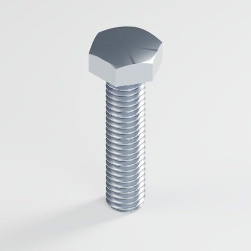
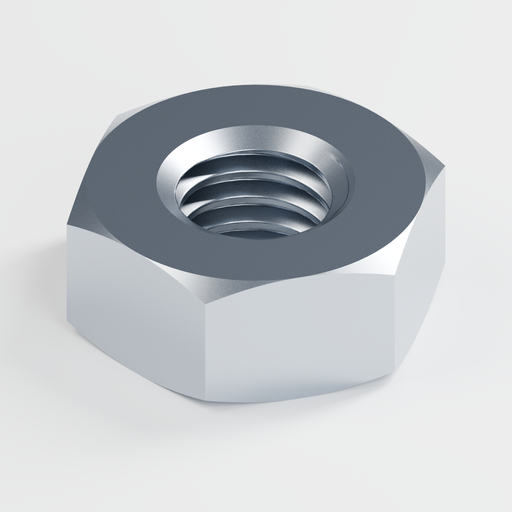
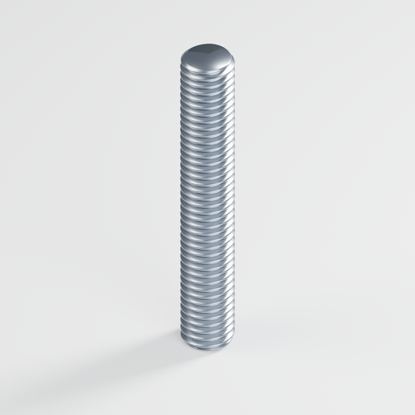

<!-- Generated by working_readme.py; edit presentation/README.template.md. -->
# OOMP bolts, nuts and washers

## Summary

A browsable library of bolts, fully threaded hex-head set screws, nuts, washers and threaded rod. Each part has its own record with available models, drawings, labels and supplier information.

**[Browse the hardware catalogue](navigation_oobb/README.md)** · [Open all part folders](parts/)

| [M6 × 25 mm hex-head set screw](parts/hardware_set_screw_m6_25_mm_length/) | [M3 hex nut](parts/hardware_nut_m3/) | [M8 × 50 mm threaded rod](parts/hardware_threaded_rod_m8_50_mm_length/) |
| --- | --- | --- |
|  |  |  |

Examples from the catalogue, with full thread detail. Click an image for the original full-resolution render, or its name for the part record. Images are not to a common scale.

## Details

Use the navigation to choose a family and exact size, then open its canonical part folder. The catalogue currently contains **254 part records**.

Depending on the part, its folder includes 3D models, dimensioned drawings, preview images, labels and structured metadata. Full models include thread detail; display models simplify geometry. Refer to the individual record and model notes for dimensions, source evidence and any approximations. These are catalogue models, not verified manufacturing drawings.

M3, M4, M5, M6 and M8 threaded rods are available in 50, 100, 150, 300 and 1000 mm overall lengths. Rods of 300 mm and longer include GLB models, OpenSCAD source, Blender scenes and renders; STL exports are intentionally omitted.

## Parts

| Family | Browse | Records |
| --- | --- | ---: |
| Bolts | [Partially threaded hex-head bolts.](navigation_oobb/README.md#bolts) | 40 |
| Nuts | [Plain, locking, flanged, coupling and specialist nuts.](navigation_oobb/README.md#nuts) | 61 |
| Set screws | [Fully threaded hex-head screws, including nylon variants.](navigation_oobb/README.md#set-screws) | 85 |
| Threaded rod | [Threaded rod records by diameter and length.](navigation_oobb/README.md#threaded-rod) | 47 |
| Washers | [Plain and large-diameter washers.](navigation_oobb/README.md#washers) | 21 |

[Lightweight YAML and thumbnail variant](https://github.com/oomlout/oomp_hardware_bolt_version_5_only_yaml) · [Other OOMP catalogues](https://github.com/oomlout/oomlout_oomp_version_5)

## Assembly

Choose matching thread sizes, lengths and hardware types for your project. Installation requirements depend on the selected part and assembly; this repository does not define a single assembly procedure.

For contributors, [generator setup and maintenance](README_GENERATOR.md) covers running or modifying the code.
