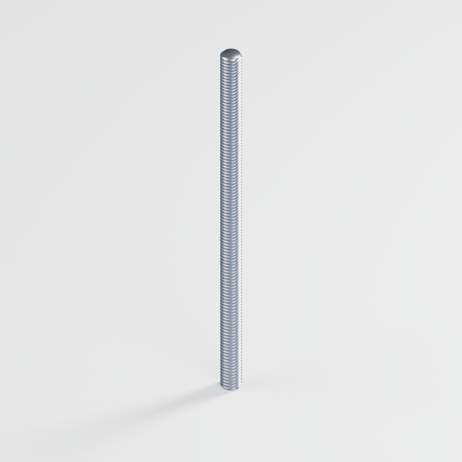
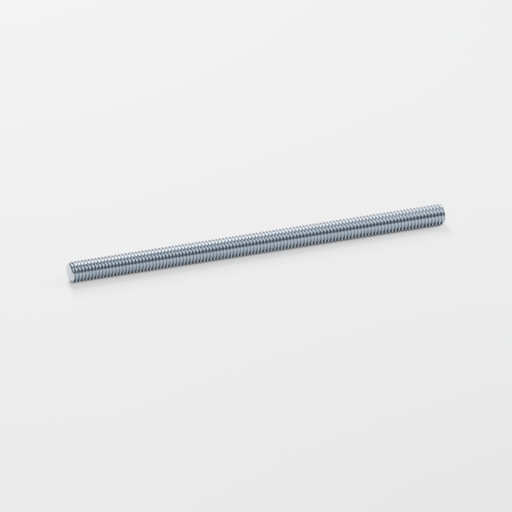

<!-- hardware-part:start -->
# M2.7 × 50 mm threaded rod

## Summary

A headless threaded rod, recorded at the stated overall end-to-end length.

[Hardware catalogue](../../README.md) · [Browse this family](../../navigation_oobb/README.md#threaded-rod)

| Isometric | Product view |
| --- | --- |
| [](three_d_model/render_high.png) | [](three_d_model/render_product_high.png) |

Full-detail catalogue renders. Click either image to open the original resolution.

## Details

**OOMP ID:** `hardware_threaded_rod_m2_7_50_mm_length`

**Short code:** `4vkyq` · **Three-word label:** language yellow media

| Model dimension | mm |
| --- | ---: |
| Nominal size | 2.7 |
| Thread pitch | 0.45 |
| Length | 50 |
| Modelled thread length | 50 |

Length convention: overall end-to-end length.

Dimensions above are values used by the saved model recipe, in millimetres. **Model basis: approximate visual model.**

<details>
<summary>Model provenance and assumptions</summary>

**Recorded dimensional reference:** APPROXIMATE VISUAL MODEL: Nominal metric fully threaded rod, cut to catalogue length

**Source checked:** 2026-11-15

**Length status:** user specified cut length

**Visual finish:** Satin steel

**Finish assumption:** Visual finish approximation; catalogue specifies colour only.

**Family notes:** No verified M2.7 rod pitch supplied. Uses the existing catalogue M2.7 nut&#x27;s selected 0.45 mm pitch; nominal diameter remains 2.7 mm. Confirm pitch before manufacturing or purchasing mating parts.

These are saved catalogue references and modelling choices, not a claim of manufacturing certification.

- [Accu metric coarse thread dimensions](https://i.accu.co.uk/documents/marketing/Thread-Size-Sheet-V2.pdf)
- [ISO 68-1:1998 basic ISO metric thread profile](https://cdn.standards.iteh.ai/samples/3707/43667a380e834371825604fbc6d63336/ISO-68-1-1998.pdf)

[Detailed model notes](three_d_model/model_notes.md)

[Complete model recipe](three_d_model/parameters.json)

</details>

<details>
<summary>Complete part metadata</summary>

[Source working.yaml](working.yaml)

```yaml
bip_39_2_word_array:
- language
- yellow
bip_39_2_word_no_space: languageyellow
bip_39_2_word_space: language yellow
bip_39_2_word_underscore: language_yellow
bip_39_3_word_array:
- language
- yellow
- media
bip_39_3_word_no_space: languageyellowmedia
bip_39_3_word_space: language yellow media
bip_39_3_word_underscore: language_yellow_media
bip_39_full_array:
- language
- yellow
- media
- estate
- toddler
- swear
- speak
- sorry
- rifle
- pilot
- very
- daughter
bip_39_full_no_space: languageyellowmediaestatetoddlerswearspeaksorryriflepilotverydaughter
bip_39_full_space: language yellow media estate toddler swear speak sorry rifle pilot
  very daughter
bip_39_full_underscore: language_yellow_media_estate_toddler_swear_speak_sorry_rifle_pilot_very_daughter
directory: parts/hardware_threaded_rod_m2_7_50_mm_length
filter: hardware_threaded_rod_*
generate_stl: true
id: hardware_threaded_rod_m2_7_50_mm_length
id_no_class: hardware_threaded_rod_m2_7_50_mm_length
id_no_size: hardware_threaded_rod_m2_7_50_mm_length
id_no_type: hardware_threaded_rod_m2_7_50_mm_length
id_svg: hardware_threaded_rod_m2_7_50_mm_length
kwargs:
  diameter_mm: 2.7
  filter: ''
  generate_stl: true
  length_mm: 50
  navigation: false
  oomp_description_extra: ''
  oomp_description_main: _
  oomp_mode: project
  overwrite: true
  part_filter: hardware_threaded_rod_*
  pitch_mm: 0.45
  run_action: false
  run_only_yaml: false
  run_oomp: true
  run_oomp_populate: true
  run_scad: true
  run_svg: true
  run_three_d_model: false
  type: default_threaded_rod
label_drawer: &id001
  bip39: language yellow media
  bip39_size: 2.066
  code: TR
  description: Threaded rod / M2.7 / 50 mm
  detail_lines: []
  detail_size: 2.05
  detail_y: 21.1
  diagram: <path d="M2 5H18V9H2Z M4 5L3 9 M6 5L5 9 M8 5L7 9 M10 5L9 9 M12 5L11 9 M14
    5L13 9 M16 5L15 9"/>
  drive_symbol: ''
  length: '50'
  length_size: 7.8
  length_x: 18.02234375
  name: Threaded rod
  name_lines:
  - Threaded rod
  name_size: 3.2
  thread: M2.7
  thread_size: 4.408
link_github: https://github.com/oomlout/oomlout_oomp_version_1_messy/tree/main/parts/hardware_threaded_rod_m2_7_50_mm_length
link_main: https://github.com/oomlout/oomlout_oomp_version_1_messy/tree/main/parts/hardware_threaded_rod_m2_7_50_mm_length
link_redirect: https://github.com/oomlout/oomlout_oomp_version_1_messy/tree/main/parts/hardware_threaded_rod_m2_7_50_mm_length
md5: 7cffe229a6be37b734367bb9b49fcb9b
md5_10: 7cffe229a6
md5_10_upper: 7CFFE229A6
md5_5: 7cffe
md5_5_upper: 7CFFE
md5_6: 7cffe2
md5_6_alpha: 4vkyq
md5_6_alpha_upper: 4VKYQ
md5_6_upper: 7CFFE2
name: Hardware Threaded Rod M2 7 50 Mm Length
name_no_class: Hardware Threaded Rod M2 7 50 Mm Length
name_no_size: Hardware Threaded Rod M2 7 50 Mm Length
name_no_type: Hardware Threaded Rod M2 7 50 Mm Length
name_proper: Hardware Threaded Rod M2 7 50 Mm Length
name_space: hardware threaded rod m2 7 50 mm length
name_upper: HARDWARE THREADED ROD M2 7 50 MM LENGTH
oobb_details:
  diameter_mm: 2.7
  length_mm: 50
  oobb_name: threaded_rod
  pitch_mm: 0.45
oobb_name: threaded_rod
oomlout_ai_roboclick_1:
  actions:
  - command: text_jinja_template
    convert_to_pdf: false
    convert_to_png: false
    dict_data:
      directory: parts\hardware_threaded_rod_m2_7_50_mm_length
      name: hardware_threaded_rod_m2_7_50_mm_length
      name_proper: Hardware Threaded Rod M2 7 50 Mm Length
      name_space: hardware threaded rod m2 7 50 mm length
      name_upper: HARDWARE THREADED ROD M2 7 50 MM LENGTH
      oobb_details:
        diameter_mm: 2.7
        length_mm: 50
        oobb_name: threaded_rod
        pitch_mm: 0.45
      svg_details:
      - diameter_mm: 2.7
        length_mm: 50
        pitch_mm: 0.45
        svg_name: threaded_rod
      - diameter_mm: 2.7
        filename: working_mechanical_drawing
        length_mm: 50
        pitch_mm: 0.45
        svg_name: threaded_rod_drawing
      taxonomy_1: hardware
      taxonomy_10: ''
      taxonomy_11: ''
      taxonomy_12: ''
      taxonomy_13: ''
      taxonomy_14: ''
      taxonomy_15: ''
      taxonomy_2: threaded_rod
      taxonomy_3: m2_7
      taxonomy_4: ''
      taxonomy_5: ''
      taxonomy_6: ''
      taxonomy_7: 50_mm_length
      taxonomy_8: ''
      taxonomy_9: ''
      three_d_model_details:
        checked_on: '2026-11-15'
        coordinate_system:
          axis: +Z along rod
          glb_conversion: (x,y,z) mm -> (x,z,-y)/1000 metres
          glb_units: metres
          glb_up_axis: Y
          origin: lower end centre
          stl_units: mm
        dimension_status: approximate_visual_model
        dimensional_specification: 'APPROXIMATE VISUAL MODEL: Nominal metric fully
          threaded rod, cut to catalogue length'
        generator: metric_threaded_rod
        length_status: user_specified_cut_length
        material:
          base_colour_srgb:
          - 0.62
          - 0.65
          - 0.69
          coat_roughness: 0.28
          coat_weight: 0.02
          metallic: 1.0
          microtexture_height_um: 0.8
          microtexture_spacing_mm: 0.025
          name: Satin steel
          note: Visual finish approximation; catalogue specifies colour only.
          roughness: 0.26
          roughness_variation: 0.045
        model_formats:
        - stl
        - glb
        modelling_choices:
          bearing: No head or bearing surface.
          cavity: Solid headless rod.
          certification: Nominal visual catalogue model, not manufacturing tolerance
            certification.
          chamfer: 'Both ends: visual 45 degree chamfer, axial depth P/2.'
          components: One closed solid.
          dimension_selection: Nominal thread diameter and sourced coarse pitch; user-specified
            overall cut length.
          display: Smooth nominal external-thread envelope or smooth minor-diameter
            internal bore; lower angular and fillet tessellation.
          family_note: No verified M2.7 rod pitch supplied. Uses the existing catalogue
            M2.7 nut's selected 0.45 mm pitch; nominal diameter remains 2.7 mm. Confirm
            pitch before manufacturing or purchasing mating parts.
          markings: Supplier and property-class markings omitted because catalogue
            does not identify them.
          runout: Continuous external thread, clipped by end chamfers; no plain shank.
          thread: Nominal ISO basic metric profile, no ISO 965 tolerance offsets.
            External rounded root H/6, internal P/4 crest and P/8 root flats.
          unspecified_geometry: Nut mouth for supplier rows without limits and flange
            M3/M4 thickness/rim blends are explicit visual model selections.
        output_folder: three_d_model
        parameters:
          characteristic_dimension_basis: nominal axial thread diameter
          characteristic_dimension_mm: 2.7
          expected_components: 1
          external_minor_diameter_mm: 2.1479088050874204
          family: rod
          finish: satin
          handedness: right
          identity: hardware_threaded_rod_m2_7_50_mm_length
          internal_minor_diameter_mm: 2.2128607103712534
          length_convention: overall end-to-end length
          length_mm: 50.0
          nominal_diameter_mm: 2.7
          overall_height_mm: 50.0
          pitch_mm: 0.45
          specification: 'APPROXIMATE VISUAL MODEL: Nominal metric fully threaded
            rod, cut to catalogue length'
          thread_end_z_mm: 50.0
          thread_flank_angle_degrees: 60.0
          thread_length_mm: 50.0
          thread_mode: full
          thread_pitch_diameter_mm: 2.407716426222752
          thread_runout_mm: 0.0
          thread_starts: 1
          tip_chamfer_mm: 0.225
        renders:
          high:
            file: render_high.png
            pixels: 2048
            variant: full
            view: isometric
          low:
            file: render_low.png
            pixels: 512
            variant: display
            view: isometric
          product_high:
            file: render_product_high.png
            pixels: 2048
            variant: full
            view: product
          product_low:
            file: render_product_low.png
            pixels: 512
            variant: display
            view: product
        schema_version: 1
        source_table: source_file/standards/threaded_rod.yaml
        sources:
        - title: Accu metric coarse thread dimensions
          url: https://i.accu.co.uk/documents/marketing/Thread-Size-Sheet-V2.pdf
        - title: ISO 68-1:1998 basic ISO metric thread profile
          url: https://cdn.standards.iteh.ai/samples/3707/43667a380e834371825604fbc6d63336/ISO-68-1-1998.pdf
        standard: null
        standard_lengths_mm: []
        standard_limits: {}
        studio:
          adaptive_threshold: 0.015
          denoise: true
          device: auto
          engine: cycles
          exposure: 0.0
          floor_colour_srgb:
          - 0.93
          - 0.935
          - 0.94
          floor_roughness: 0.55
          framing_margin: 0.13
          high_samples: 160
          lights:
          - colour:
            - 1.0
            - 0.96
            - 0.9
            height: 5.0
            name: Key softbox
            position:
            - -3
            - -4
            - 6
            power: 650.0
            width: 4.0
          - colour:
            - 0.9
            - 0.95
            - 1.0
            height: 4.0
            name: Fill softbox
            position:
            - 4
            - -1
            - 3
            power: 330.0
            width: 3.0
          - colour:
            - 1.0
            - 1.0
            - 1.0
            height: 5.0
            name: Rim strip
            position:
            - 1
            - 4
            - 4
            power: 850.0
            width: 1.2
          look: AgX - Medium High Contrast
          low_samples: 48
          poses:
            isometric:
              camera_eye:
              - 1
              - -1
              - 1
              orientation: principal axis Z up
              projection: orthographic
            product:
              camera_eye:
              - -6
              - -10
              - 6
              orientation: lying on side, axial end to left
              projection: orthographic
              resting_axis: side
              support: Stable convex-hull support using actual mesh centre of mass.
              yaw_degrees: -12.0
          seed: 7991
          view_transform: AgX
          world_colour:
          - 0.78
          - 0.82
          - 0.9
          world_strength: 0.35
        units: mm
        variants:
          display:
            angular_segments: 24
            fillet_segments: 3
            samples_per_pitch: 1
          full:
            angular_segments: 48
            fillet_segments: 12
            samples_per_pitch: 16
        views:
        - isometric
        - front
        - back
        - left
        - right
        - top
        - bottom
      url_chat: ''
    dict_data_files: {}
    dict_data_files_exists: {}
    file_output: label_oomp.svg
    file_template: C:\gh\oomp_hardware_bolt_version_5\source_file\template_jinja\template_jinja_label_oomlout_76_2_mm_50_8_mm\working.svg.j2
    search_and_replace: []
  file_test: label_oomp.pdf
  retries_until_complete: 0
oomlout_ai_roboclick_2:
  actions:
  - command: text_jinja_template
    convert_to_pdf: false
    convert_to_png: false
    dict_data:
      directory: parts\hardware_threaded_rod_m2_7_50_mm_length
      name: hardware_threaded_rod_m2_7_50_mm_length
      name_proper: Hardware Threaded Rod M2 7 50 Mm Length
      name_space: hardware threaded rod m2 7 50 mm length
      name_upper: HARDWARE THREADED ROD M2 7 50 MM LENGTH
      oobb_details:
        diameter_mm: 2.7
        length_mm: 50
        oobb_name: threaded_rod
        pitch_mm: 0.45
      oomlout_ai_roboclick_1:
        actions:
        - command: text_jinja_template
          convert_to_pdf: false
          convert_to_png: false
          dict_data:
            directory: parts\hardware_threaded_rod_m2_7_50_mm_length
            name: hardware_threaded_rod_m2_7_50_mm_length
            name_proper: Hardware Threaded Rod M2 7 50 Mm Length
            name_space: hardware threaded rod m2 7 50 mm length
            name_upper: HARDWARE THREADED ROD M2 7 50 MM LENGTH
            oobb_details:
              diameter_mm: 2.7
              length_mm: 50
              oobb_name: threaded_rod
              pitch_mm: 0.45
            svg_details:
            - diameter_mm: 2.7
              length_mm: 50
              pitch_mm: 0.45
              svg_name: threaded_rod
            - diameter_mm: 2.7
              filename: working_mechanical_drawing
              length_mm: 50
              pitch_mm: 0.45
              svg_name: threaded_rod_drawing
            taxonomy_1: hardware
            taxonomy_10: ''
            taxonomy_11: ''
            taxonomy_12: ''
            taxonomy_13: ''
            taxonomy_14: ''
            taxonomy_15: ''
            taxonomy_2: threaded_rod
            taxonomy_3: m2_7
            taxonomy_4: ''
            taxonomy_5: ''
            taxonomy_6: ''
            taxonomy_7: 50_mm_length
            taxonomy_8: ''
            taxonomy_9: ''
            three_d_model_details:
              checked_on: '2026-11-15'
              coordinate_system:
                axis: +Z along rod
                glb_conversion: (x,y,z) mm -> (x,z,-y)/1000 metres
                glb_units: metres
                glb_up_axis: Y
                origin: lower end centre
                stl_units: mm
              dimension_status: approximate_visual_model
              dimensional_specification: 'APPROXIMATE VISUAL MODEL: Nominal metric
                fully threaded rod, cut to catalogue length'
              generator: metric_threaded_rod
              length_status: user_specified_cut_length
              material:
                base_colour_srgb:
                - 0.62
                - 0.65
                - 0.69
                coat_roughness: 0.28
                coat_weight: 0.02
                metallic: 1.0
                microtexture_height_um: 0.8
                microtexture_spacing_mm: 0.025
                name: Satin steel
                note: Visual finish approximation; catalogue specifies colour only.
                roughness: 0.26
                roughness_variation: 0.045
              model_formats:
              - stl
              - glb
              modelling_choices:
                bearing: No head or bearing surface.
                cavity: Solid headless rod.
                certification: Nominal visual catalogue model, not manufacturing tolerance
                  certification.
                chamfer: 'Both ends: visual 45 degree chamfer, axial depth P/2.'
                components: One closed solid.
                dimension_selection: Nominal thread diameter and sourced coarse pitch;
                  user-specified overall cut length.
                display: Smooth nominal external-thread envelope or smooth minor-diameter
                  internal bore; lower angular and fillet tessellation.
                family_note: No verified M2.7 rod pitch supplied. Uses the existing
                  catalogue M2.7 nut's selected 0.45 mm pitch; nominal diameter remains
                  2.7 mm. Confirm pitch before manufacturing or purchasing mating
                  parts.
                markings: Supplier and property-class markings omitted because catalogue
                  does not identify them.
                runout: Continuous external thread, clipped by end chamfers; no plain
                  shank.
                thread: Nominal ISO basic metric profile, no ISO 965 tolerance offsets.
                  External rounded root H/6, internal P/4 crest and P/8 root flats.
                unspecified_geometry: Nut mouth for supplier rows without limits and
                  flange M3/M4 thickness/rim blends are explicit visual model selections.
              output_folder: three_d_model
              parameters:
                characteristic_dimension_basis: nominal axial thread diameter
                characteristic_dimension_mm: 2.7
                expected_components: 1
                external_minor_diameter_mm: 2.1479088050874204
                family: rod
                finish: satin
                handedness: right
                identity: hardware_threaded_rod_m2_7_50_mm_length
                internal_minor_diameter_mm: 2.2128607103712534
                length_convention: overall end-to-end length
                length_mm: 50.0
                nominal_diameter_mm: 2.7
                overall_height_mm: 50.0
                pitch_mm: 0.45
                specification: 'APPROXIMATE VISUAL MODEL: Nominal metric fully threaded
                  rod, cut to catalogue length'
                thread_end_z_mm: 50.0
                thread_flank_angle_degrees: 60.0
                thread_length_mm: 50.0
                thread_mode: full
                thread_pitch_diameter_mm: 2.407716426222752
                thread_runout_mm: 0.0
                thread_starts: 1
                tip_chamfer_mm: 0.225
              renders:
                high:
                  file: render_high.png
                  pixels: 2048
                  variant: full
                  view: isometric
                low:
                  file: render_low.png
                  pixels: 512
                  variant: display
                  view: isometric
                product_high:
                  file: render_product_high.png
                  pixels: 2048
                  variant: full
                  view: product
                product_low:
                  file: render_product_low.png
                  pixels: 512
                  variant: display
                  view: product
              schema_version: 1
              source_table: source_file/standards/threaded_rod.yaml
              sources:
              - title: Accu metric coarse thread dimensions
                url: https://i.accu.co.uk/documents/marketing/Thread-Size-Sheet-V2.pdf
              - title: ISO 68-1:1998 basic ISO metric thread profile
                url: https://cdn.standards.iteh.ai/samples/3707/43667a380e834371825604fbc6d63336/ISO-68-1-1998.pdf
              standard: null
              standard_lengths_mm: []
              standard_limits: {}
              studio:
                adaptive_threshold: 0.015
                denoise: true
                device: auto
                engine: cycles
                exposure: 0.0
                floor_colour_srgb:
                - 0.93
                - 0.935
                - 0.94
                floor_roughness: 0.55
                framing_margin: 0.13
                high_samples: 160
                lights:
                - colour:
                  - 1.0
                  - 0.96
                  - 0.9
                  height: 5.0
                  name: Key softbox
                  position:
                  - -3
                  - -4
                  - 6
                  power: 650.0
                  width: 4.0
                - colour:
                  - 0.9
                  - 0.95
                  - 1.0
                  height: 4.0
                  name: Fill softbox
                  position:
                  - 4
                  - -1
                  - 3
                  power: 330.0
                  width: 3.0
                - colour:
                  - 1.0
                  - 1.0
                  - 1.0
                  height: 5.0
                  name: Rim strip
                  position:
                  - 1
                  - 4
                  - 4
                  power: 850.0
                  width: 1.2
                look: AgX - Medium High Contrast
                low_samples: 48
                poses:
                  isometric:
                    camera_eye:
                    - 1
                    - -1
                    - 1
                    orientation: principal axis Z up
                    projection: orthographic
                  product:
                    camera_eye:
                    - -6
                    - -10
                    - 6
                    orientation: lying on side, axial end to left
                    projection: orthographic
                    resting_axis: side
                    support: Stable convex-hull support using actual mesh centre of
                      mass.
                    yaw_degrees: -12.0
                seed: 7991
                view_transform: AgX
                world_colour:
                - 0.78
                - 0.82
                - 0.9
                world_strength: 0.35
              units: mm
              variants:
                display:
                  angular_segments: 24
                  fillet_segments: 3
                  samples_per_pitch: 1
                full:
                  angular_segments: 48
                  fillet_segments: 12
                  samples_per_pitch: 16
              views:
              - isometric
              - front
              - back
              - left
              - right
              - top
              - bottom
            url_chat: ''
          dict_data_files: {}
          dict_data_files_exists: {}
          file_output: label_oomp.svg
          file_template: C:\gh\oomp_hardware_bolt_version_5\source_file\template_jinja\template_jinja_label_oomlout_76_2_mm_50_8_mm\working.svg.j2
          search_and_replace: []
        file_test: label_oomp.pdf
        retries_until_complete: 0
      svg_details:
      - diameter_mm: 2.7
        length_mm: 50
        pitch_mm: 0.45
        svg_name: threaded_rod
      - diameter_mm: 2.7
        filename: working_mechanical_drawing
        length_mm: 50
        pitch_mm: 0.45
        svg_name: threaded_rod_drawing
      taxonomy_1: hardware
      taxonomy_10: ''
      taxonomy_11: ''
      taxonomy_12: ''
      taxonomy_13: ''
      taxonomy_14: ''
      taxonomy_15: ''
      taxonomy_2: threaded_rod
      taxonomy_3: m2_7
      taxonomy_4: ''
      taxonomy_5: ''
      taxonomy_6: ''
      taxonomy_7: 50_mm_length
      taxonomy_8: ''
      taxonomy_9: ''
      three_d_model_details:
        checked_on: '2026-11-15'
        coordinate_system:
          axis: +Z along rod
          glb_conversion: (x,y,z) mm -> (x,z,-y)/1000 metres
          glb_units: metres
          glb_up_axis: Y
          origin: lower end centre
          stl_units: mm
        dimension_status: approximate_visual_model
        dimensional_specification: 'APPROXIMATE VISUAL MODEL: Nominal metric fully
          threaded rod, cut to catalogue length'
        generator: metric_threaded_rod
        length_status: user_specified_cut_length
        material:
          base_colour_srgb:
          - 0.62
          - 0.65
          - 0.69
          coat_roughness: 0.28
          coat_weight: 0.02
          metallic: 1.0
          microtexture_height_um: 0.8
          microtexture_spacing_mm: 0.025
          name: Satin steel
          note: Visual finish approximation; catalogue specifies colour only.
          roughness: 0.26
          roughness_variation: 0.045
        model_formats:
        - stl
        - glb
        modelling_choices:
          bearing: No head or bearing surface.
          cavity: Solid headless rod.
          certification: Nominal visual catalogue model, not manufacturing tolerance
            certification.
          chamfer: 'Both ends: visual 45 degree chamfer, axial depth P/2.'
          components: One closed solid.
          dimension_selection: Nominal thread diameter and sourced coarse pitch; user-specified
            overall cut length.
          display: Smooth nominal external-thread envelope or smooth minor-diameter
            internal bore; lower angular and fillet tessellation.
          family_note: No verified M2.7 rod pitch supplied. Uses the existing catalogue
            M2.7 nut's selected 0.45 mm pitch; nominal diameter remains 2.7 mm. Confirm
            pitch before manufacturing or purchasing mating parts.
          markings: Supplier and property-class markings omitted because catalogue
            does not identify them.
          runout: Continuous external thread, clipped by end chamfers; no plain shank.
          thread: Nominal ISO basic metric profile, no ISO 965 tolerance offsets.
            External rounded root H/6, internal P/4 crest and P/8 root flats.
          unspecified_geometry: Nut mouth for supplier rows without limits and flange
            M3/M4 thickness/rim blends are explicit visual model selections.
        output_folder: three_d_model
        parameters:
          characteristic_dimension_basis: nominal axial thread diameter
          characteristic_dimension_mm: 2.7
          expected_components: 1
          external_minor_diameter_mm: 2.1479088050874204
          family: rod
          finish: satin
          handedness: right
          identity: hardware_threaded_rod_m2_7_50_mm_length
          internal_minor_diameter_mm: 2.2128607103712534
          length_convention: overall end-to-end length
          length_mm: 50.0
          nominal_diameter_mm: 2.7
          overall_height_mm: 50.0
          pitch_mm: 0.45
          specification: 'APPROXIMATE VISUAL MODEL: Nominal metric fully threaded
            rod, cut to catalogue length'
          thread_end_z_mm: 50.0
          thread_flank_angle_degrees: 60.0
          thread_length_mm: 50.0
          thread_mode: full
          thread_pitch_diameter_mm: 2.407716426222752
          thread_runout_mm: 0.0
          thread_starts: 1
          tip_chamfer_mm: 0.225
        renders:
          high:
            file: render_high.png
            pixels: 2048
            variant: full
            view: isometric
          low:
            file: render_low.png
            pixels: 512
            variant: display
            view: isometric
          product_high:
            file: render_product_high.png
            pixels: 2048
            variant: full
            view: product
          product_low:
            file: render_product_low.png
            pixels: 512
            variant: display
            view: product
        schema_version: 1
        source_table: source_file/standards/threaded_rod.yaml
        sources:
        - title: Accu metric coarse thread dimensions
          url: https://i.accu.co.uk/documents/marketing/Thread-Size-Sheet-V2.pdf
        - title: ISO 68-1:1998 basic ISO metric thread profile
          url: https://cdn.standards.iteh.ai/samples/3707/43667a380e834371825604fbc6d63336/ISO-68-1-1998.pdf
        standard: null
        standard_lengths_mm: []
        standard_limits: {}
        studio:
          adaptive_threshold: 0.015
          denoise: true
          device: auto
          engine: cycles
          exposure: 0.0
          floor_colour_srgb:
          - 0.93
          - 0.935
          - 0.94
          floor_roughness: 0.55
          framing_margin: 0.13
          high_samples: 160
          lights:
          - colour:
            - 1.0
            - 0.96
            - 0.9
            height: 5.0
            name: Key softbox
            position:
            - -3
            - -4
            - 6
            power: 650.0
            width: 4.0
          - colour:
            - 0.9
            - 0.95
            - 1.0
            height: 4.0
            name: Fill softbox
            position:
            - 4
            - -1
            - 3
            power: 330.0
            width: 3.0
          - colour:
            - 1.0
            - 1.0
            - 1.0
            height: 5.0
            name: Rim strip
            position:
            - 1
            - 4
            - 4
            power: 850.0
            width: 1.2
          look: AgX - Medium High Contrast
          low_samples: 48
          poses:
            isometric:
              camera_eye:
              - 1
              - -1
              - 1
              orientation: principal axis Z up
              projection: orthographic
            product:
              camera_eye:
              - -6
              - -10
              - 6
              orientation: lying on side, axial end to left
              projection: orthographic
              resting_axis: side
              support: Stable convex-hull support using actual mesh centre of mass.
              yaw_degrees: -12.0
          seed: 7991
          view_transform: AgX
          world_colour:
          - 0.78
          - 0.82
          - 0.9
          world_strength: 0.35
        units: mm
        variants:
          display:
            angular_segments: 24
            fillet_segments: 3
            samples_per_pitch: 1
          full:
            angular_segments: 48
            fillet_segments: 12
            samples_per_pitch: 16
        views:
        - isometric
        - front
        - back
        - left
        - right
        - top
        - bottom
      url_chat: ''
    dict_data_files: {}
    dict_data_files_exists: {}
    file_output: label_bolt_image.svg
    file_template: C:\gh\oomp_hardware_bolt_version_5\source_file\template_jinja\oomp_hardware_bolt_version_5\template_jinja_label_oomp_bolt_76_2_mm_50_8_mm\working.svg.j2
    search_and_replace: []
  file_test: label_bolt_image.pdf
  retries_until_complete: 0
oomlout_ai_roboclick_3:
  actions:
  - command: text_jinja_template
    convert_to_pdf: false
    convert_to_png: false
    description: label_drawer
    dict_data:
      label_drawer: *id001
    file_output: label_drawer.svg
    file_template: C:\gh\oomp_hardware_bolt_version_5\source_file\template_jinja\label_drawer\working.svg.j2
  file_test: ''
oomp_key: oomp_hardware_threaded_rod_m2_7_50_mm_length
project_name: C:\gh\oomp_hardware_bolt_version_5
run_action: false
run_only_yaml: false
run_oomp: true
run_oomp_populate: true
run_scad: true
run_svg: true
run_three_d_model: false
svg_details:
- diameter_mm: 2.7
  length_mm: 50
  pitch_mm: 0.45
  svg_name: threaded_rod
- diameter_mm: 2.7
  filename: working_mechanical_drawing
  length_mm: 50
  pitch_mm: 0.45
  svg_name: threaded_rod_drawing
taxonomy_1: hardware
taxonomy_10: ''
taxonomy_11: ''
taxonomy_12: ''
taxonomy_13: ''
taxonomy_14: ''
taxonomy_15: ''
taxonomy_1_capital: Hardware
taxonomy_1_first_letter: h
taxonomy_1_first_letter_upper: H
taxonomy_1_length_1: h
taxonomy_1_length_2: ha
taxonomy_1_length_3: har
taxonomy_1_length_4: hard
taxonomy_1_length_5: hardw
taxonomy_1_upper: HARDWARE
taxonomy_1_upper_length_1: H
taxonomy_1_upper_length_2: HA
taxonomy_1_upper_length_3: HAR
taxonomy_1_upper_length_4: HARD
taxonomy_1_upper_length_5: HARDW
taxonomy_2: threaded_rod
taxonomy_2_capital: Threaded Rod
taxonomy_2_first_letter: t
taxonomy_2_first_letter_upper: T
taxonomy_2_length_1: t
taxonomy_2_length_2: th
taxonomy_2_length_3: thr
taxonomy_2_length_4: thre
taxonomy_2_length_5: threa
taxonomy_2_upper: THREADED_ROD
taxonomy_2_upper_length_1: T
taxonomy_2_upper_length_2: TH
taxonomy_2_upper_length_3: THR
taxonomy_2_upper_length_4: THRE
taxonomy_2_upper_length_5: THREA
taxonomy_3: m2_7
taxonomy_3_capital: M2.7
taxonomy_3_first_letter: m
taxonomy_3_first_letter_upper: M
taxonomy_3_length_1: m
taxonomy_3_length_2: m2
taxonomy_3_length_3: m2_
taxonomy_3_length_4: m2_7
taxonomy_3_length_5: m2_7
taxonomy_3_upper: M2_7
taxonomy_3_upper_length_1: M
taxonomy_3_upper_length_2: M2
taxonomy_3_upper_length_3: M2_
taxonomy_3_upper_length_4: M2_7
taxonomy_3_upper_length_5: M2_7
taxonomy_4: ''
taxonomy_5: ''
taxonomy_6: ''
taxonomy_7: 50_mm_length
taxonomy_7_capital: 50 mm Length
taxonomy_7_first_letter: '5'
taxonomy_7_first_letter_upper: '5'
taxonomy_7_length_1: '5'
taxonomy_7_length_2: '50'
taxonomy_7_length_3: '50_'
taxonomy_7_length_4: 50_m
taxonomy_7_length_5: 50_mm
taxonomy_7_upper: 50_MM_LENGTH
taxonomy_7_upper_length_1: '5'
taxonomy_7_upper_length_2: '50'
taxonomy_7_upper_length_3: '50_'
taxonomy_7_upper_length_4: 50_M
taxonomy_7_upper_length_5: 50_MM
taxonomy_8: ''
taxonomy_9: ''
three_d_model_details:
  schema_version: 1
  generator: metric_threaded_rod
  output_folder: three_d_model
  units: mm
  standard: null
  dimensional_specification: 'APPROXIMATE VISUAL MODEL: Nominal metric fully threaded
    rod, cut to catalogue length'
  dimension_status: approximate_visual_model
  length_status: user_specified_cut_length
  sources:
  - title: Accu metric coarse thread dimensions
    url: https://i.accu.co.uk/documents/marketing/Thread-Size-Sheet-V2.pdf
  - title: ISO 68-1:1998 basic ISO metric thread profile
    url: https://cdn.standards.iteh.ai/samples/3707/43667a380e834371825604fbc6d63336/ISO-68-1-1998.pdf
  checked_on: '2026-11-15'
  source_table: source_file/standards/threaded_rod.yaml
  standard_limits: {}
  standard_lengths_mm: []
  parameters:
    family: rod
    nominal_diameter_mm: 2.7
    finish: satin
    identity: hardware_threaded_rod_m2_7_50_mm_length
    specification: 'APPROXIMATE VISUAL MODEL: Nominal metric fully threaded rod, cut
      to catalogue length'
    expected_components: 1
    handedness: right
    thread_starts: 1
    thread_flank_angle_degrees: 60.0
    pitch_mm: 0.45
    length_mm: 50.0
    overall_height_mm: 50.0
    length_convention: overall end-to-end length
    thread_mode: full
    thread_length_mm: 50.0
    thread_end_z_mm: 50.0
    thread_runout_mm: 0.0
    tip_chamfer_mm: 0.225
    characteristic_dimension_mm: 2.7
    characteristic_dimension_basis: nominal axial thread diameter
    thread_pitch_diameter_mm: 2.407716426222752
    external_minor_diameter_mm: 2.1479088050874204
    internal_minor_diameter_mm: 2.2128607103712534
  modelling_choices:
    dimension_selection: Nominal thread diameter and sourced coarse pitch; user-specified
      overall cut length.
    thread: Nominal ISO basic metric profile, no ISO 965 tolerance offsets. External
      rounded root H/6, internal P/4 crest and P/8 root flats.
    runout: Continuous external thread, clipped by end chamfers; no plain shank.
    chamfer: 'Both ends: visual 45 degree chamfer, axial depth P/2.'
    bearing: No head or bearing surface.
    cavity: Solid headless rod.
    display: Smooth nominal external-thread envelope or smooth minor-diameter internal
      bore; lower angular and fillet tessellation.
    components: One closed solid.
    markings: Supplier and property-class markings omitted because catalogue does
      not identify them.
    unspecified_geometry: Nut mouth for supplier rows without limits and flange M3/M4
      thickness/rim blends are explicit visual model selections.
    family_note: No verified M2.7 rod pitch supplied. Uses the existing catalogue
      M2.7 nut's selected 0.45 mm pitch; nominal diameter remains 2.7 mm. Confirm
      pitch before manufacturing or purchasing mating parts.
    certification: Nominal visual catalogue model, not manufacturing tolerance certification.
  coordinate_system:
    origin: lower end centre
    axis: +Z along rod
    stl_units: mm
    glb_units: metres
    glb_up_axis: Y
    glb_conversion: (x,y,z) mm -> (x,z,-y)/1000 metres
  variants:
    full:
      angular_segments: 48
      samples_per_pitch: 16
      fillet_segments: 12
    display:
      angular_segments: 24
      samples_per_pitch: 1
      fillet_segments: 3
  views:
  - isometric
  - front
  - back
  - left
  - right
  - top
  - bottom
  model_formats:
  - stl
  - glb
  material:
    name: Satin steel
    base_colour_srgb:
    - 0.62
    - 0.65
    - 0.69
    metallic: 1.0
    roughness: 0.26
    roughness_variation: 0.045
    coat_weight: 0.02
    coat_roughness: 0.28
    microtexture_spacing_mm: 0.025
    microtexture_height_um: 0.8
    note: Visual finish approximation; catalogue specifies colour only.
  studio:
    engine: cycles
    device: auto
    seed: 7991
    low_samples: 48
    high_samples: 160
    adaptive_threshold: 0.015
    denoise: true
    view_transform: AgX
    look: AgX - Medium High Contrast
    exposure: 0.0
    world_colour:
    - 0.78
    - 0.82
    - 0.9
    world_strength: 0.35
    floor_colour_srgb:
    - 0.93
    - 0.935
    - 0.94
    floor_roughness: 0.55
    framing_margin: 0.13
    lights:
    - name: Key softbox
      position:
      - -3
      - -4
      - 6
      power: 650.0
      width: 4.0
      height: 5.0
      colour:
      - 1.0
      - 0.96
      - 0.9
    - name: Fill softbox
      position:
      - 4
      - -1
      - 3
      power: 330.0
      width: 3.0
      height: 4.0
      colour:
      - 0.9
      - 0.95
      - 1.0
    - name: Rim strip
      position:
      - 1
      - 4
      - 4
      power: 850.0
      width: 1.2
      height: 5.0
      colour:
      - 1.0
      - 1.0
      - 1.0
    poses:
      isometric:
        camera_eye:
        - 1
        - -1
        - 1
        projection: orthographic
        orientation: principal axis Z up
      product:
        camera_eye:
        - -6
        - -10
        - 6
        projection: orthographic
        orientation: lying on side, axial end to left
        yaw_degrees: -12.0
        support: Stable convex-hull support using actual mesh centre of mass.
        resting_axis: side
  renders:
    low:
      file: render_low.png
      variant: display
      pixels: 512
      view: isometric
    high:
      file: render_high.png
      variant: full
      pixels: 2048
      view: isometric
    product_low:
      file: render_product_low.png
      variant: display
      pixels: 512
      view: product
    product_high:
      file: render_product_high.png
      variant: full
      pixels: 2048
      view: product
url_chat: ''
```

</details>

## Parts

[Full-detail 3D model (GLB)](three_d_model/model_full.glb) · [Simplified 3D model (GLB)](three_d_model/model_display.glb) · [Full-detail mesh (STL)](three_d_model/model_full.stl) · [Parametric model (OpenSCAD)](3dpr.scad) · [Editable studio scene (Blender)](three_d_model/studio.blend) · [Dimensioned drawing (PDF)](working_mechanical_drawing_a4.pdf) · [Full-detail view drawings](three_d_model/full/) · [Drawer label (SVG)](label_drawer.svg)

Full-detail and simplified display models are alternatives for the same part. GLB uses metres; STL, where supplied, uses millimetres. The [part folder](./) contains all available files.

## Assembly

This page documents a component rather than a complete project assembly. No installation sequence or tightening torque is specified by this record.
<!-- hardware-part:end -->
